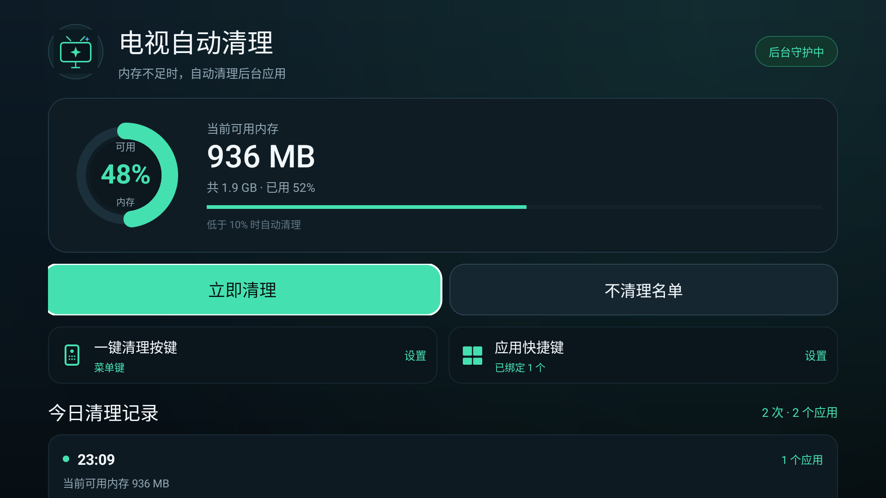
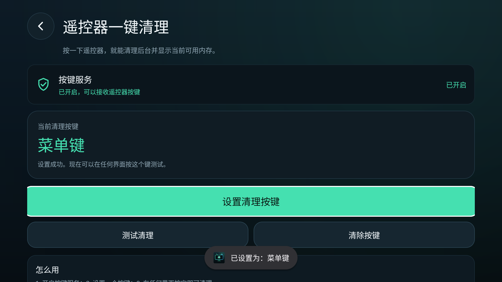
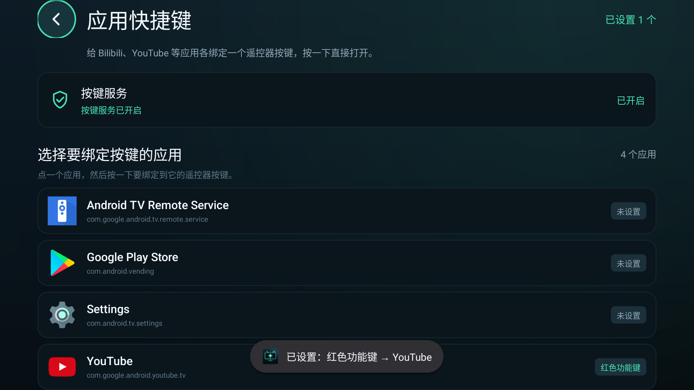
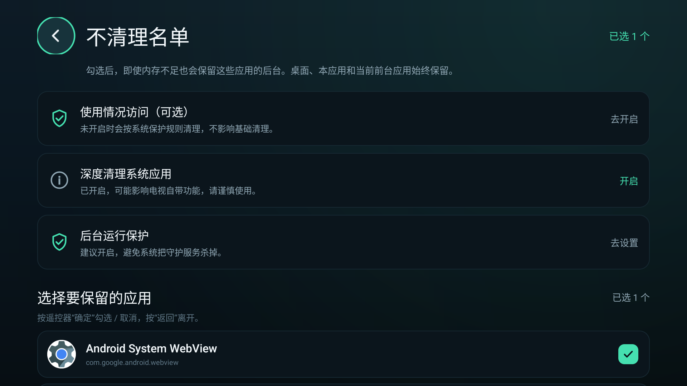

# 电视自动清理（TV Auto Clean）

一个给 Android TV / 电视盒子用的轻量后台内存清理工具，带可选的遥控器一键清理和应用快捷键。

- 包名：`com.tvautoclean.guard`
- 版本：**1.2.1**（versionCode 4）
- APK：约 **164 KB**
- 最低系统：Android 5.0（API 21）
- 32 位 / 64 位通用：没有 native `.so`
- 不需要 root，不联网

> 说明：这是一个非 root 的第三方工具，使用 Android 公开 API 做“尽力清理”，不是厂商系统级清理器，也不保证在所有电视上都能达到同样效果。

## 下载

- 仓库内 APK：[`release/TV-Auto-Clean-v1.2.1.apk`](release/TV-Auto-Clean-v1.2.1.apk)
- 也可以在 GitHub 的 **Releases** 页面下载（推荐）。
- 校验：见 [`release/SHA256SUMS.txt`](release/SHA256SUMS.txt)

安装方式：

```bash
adb install -r TV-Auto-Clean-v1.2.1.apk
```

或者把 APK 拷到 U 盘，用电视文件管理器安装。

## 界面









## 功能

### 1. 内存不足自动清理

- 前台服务每 30 秒检查一次可用内存
- 当系统报告低内存，或可用内存低于总内存约 10% 时触发
- 调用 Android 公开 API `ActivityManager.killBackgroundProcesses()`
- 不强制停止前台 App，也不需要 root

### 2. 遥控器一键清理

- 在首页“一键清理按键”卡片里绑定一颗遥控器按键
- 在任何界面按一下，清理后台
- 电视底部显示：`清理完成 · 可用内存 936 MB`
- 需要开启无障碍按键服务

### 3. 应用快捷键

- 给 Bilibili、YouTube 等已安装应用各绑定一颗遥控器按键
- 按一下直接打开对应 App
- 一颗键只能绑定一个应用；一个应用只保留一颗键
- 需要开启无障碍按键服务

### 4. 首页快捷卡片

“一键清理按键”和“应用快捷键”两个入口放在首页“今日清理记录”上方，不用进入“不清理名单”。

### 5. 自动保护

以下对象始终不会被清理：

- 电视桌面 / Launcher
- 当前前台 App（有“使用情况访问”时识别更准确）
- 本应用自己
- 系统默认输入法
- 用户在“不清理名单”里勾选的应用
- 深度清理模式下的电视核心系统包

### 6. 开机自启，不弹界面

收到开机广播后启动前台服务，不打开 Activity。部分电视需要手动允许“自启动 / 后台运行”。

### 7. 今日清理记录，只留一天

- 日志文件在应用私有目录 `files/clean_log.jsonl`
- 只保留当天记录，跨零点自动清理旧日志
- 主页只显示今天的记录
- 最多 300 条

### 8. 遥控器 UI

- 大字号、焦点高亮
- 方向键 / 确定 / 返回操作
- 不需要触摸屏

## 安装后的首次设置

1. **允许通知**：Android 13+ 会询问通知权限。允许后前台服务通知可以显示；拒绝不影响清理，只是通知隐藏。
2. **允许自启动**：在电视系统设置里找到“应用管理 / 自启动 / 后台运行 / 后台冻结”，允许“电视自动清理”。
3. **（可选）开启按键服务**：要用一键清理/应用快捷键，必须开启无障碍服务。
4. **（可选）设置不清理名单**：用遥控器勾选要保留在后台的应用。

## 开启按键服务

### 普通 Android TV

设置 → 无障碍 → **电视自动清理按键服务** → 开启。

Android 会显示一条通用警告，例如“可以收集您输入的所有文字信息（密码除外）”。这是系统对所有无障碍服务的统一提示。本应用：

- 不读取屏幕内容（`canRetrieveWindowContent=false`）
- 只比较遥控器按键码
- 不记录、不上传按键内容
- 没有 `INTERNET` 权限

### TCL 电视

TCL 的 Android TV 设置使用 OEM 入口，常见路径：

- 设置 → 系统 → 无障碍 → 电视自动清理按键服务
- 或：设置 → 设备偏好设置 → 无障碍 → 电视自动清理按键服务

App 内的“去开启”会优先打开 TCL 的无障碍页面。

### ADB 备用方法

如果电视里找不到无障碍设置，可以用 ADB：

```bash
adb shell settings put secure enabled_accessibility_services \
  com.tvautoclean.guard/com.tvautoclean.guard.KeyCleanAccessibilityService
adb shell settings put secure accessibility_enabled 1
```

> 这条命令会覆盖已有的无障碍服务列表。若电视上还有其他无障碍服务，请先读取原值，用冒号追加。部分 TCL 固件在 App 更新后会自动关闭全局无障碍，重新打开一次即可。

### 设置按键

1. 首页 →“一键清理按键”→“设置清理按键”
2. 按一下实体遥控器上想用的键
3. 建议使用已经没用的应用键、数字键、颜色键或菜单键
4. 如果按键没有反应，说明它没有发出标准 Android `KeyEvent`，换一个键

**不能使用**：返回、Home、电源、音量、方向键、确定键。这些键由系统保留。

## 兼容性与限制（重要）

### 可以做到的

- Android 5.0+ 电视/盒子安装
- 32 位、64 位都能运行（无 native 库）
- 非 root 清理后台进程
- 开机自启（需系统允许）
- 今日日志、单日清理
- 遥控器按键绑定（需无障碍）

### 做不到 / 不保证的

- **不能强杀前台 App**：非 root 第三方应用没有这个权限
- **不是系统级清理器**：清理后应用可能自动重启，释放内存因电视而异
- **不是所有电视都支持按键过滤**：部分 OEM 固件会限制第三方无障碍服务
- **不是所有遥控器键都能抓**：系统键、部分品牌专有键不会产生标准 `KeyEvent`
- **使用快捷键会占用按键**：被绑定的键原本功能会失效；没有空闲键的电视不建议使用快捷键
- **Android TV 的“应用键”可能是 Intent 而不是按键**：这种键任何第三方 App 都抓不到，只能 root 改键值
- **不建议上架 Google Play**：无障碍 API 用于非无障碍用途容易被拒；本项目适合 GitHub / F-Droid 侧载

### 普通电视用户怎么用

如果你的电视遥控器没有多余按键，**只用自动清理和“立即清理”即可**，不需要开启无障碍。

如果遥控器有颜色键、数字键、菜单键，或有一个你完全不用的应用键，才建议使用一键清理/应用快捷键。

## 权限说明

| 权限 | 用途 |
|---|---|
| `KILL_BACKGROUND_PROCESSES` | 清理后台进程 |
| `GET_TASKS` | 旧系统上辅助识别前台/任务 |
| `QUERY_ALL_PACKAGES` | 读取已安装应用列表，供清理和快捷键选择 |
| `PACKAGE_USAGE_STATS` | 可选，更准确识别当前前台 App |
| `RECEIVE_BOOT_COMPLETED` | 开机自启 |
| `FOREGROUND_SERVICE` | 持续内存守护 |
| `POST_NOTIFICATIONS` | Android 13+ 前台服务通知 |
| `REQUEST_IGNORE_BATTERY_OPTIMIZATIONS` | 可选，减少后台被系统冻结 |
| 无障碍服务 | 仅用于遥控器按键过滤，不读取窗口内容 |

APK **没有申请 `INTERNET` 权限**。

## 隐私

- 不联网、不上传数据
- 不读取屏幕内容
- 不记录按键内容
- 清理日志、不清理名单、按键映射都只存在电视本地

详见 [PRIVACY.md](PRIVACY.md)。

## 从源码构建

依赖：

- JDK 17
- Android SDK Platform 33
- Android SDK Build-Tools 33.0.2
- 不依赖 Gradle

```bash
# 1. 生成自己的签名密钥（只做一次，不要提交到 Git）
./scripts/create-keystore.sh

# 2. 设置密码和 SDK 路径
export TV_CLEAN_STORE_PASS='你的keystore密码'
export ANDROID_SDK_ROOT="$HOME/Library/Android/sdk"   # macOS 示例

# 3. 构建
./build.sh
```

输出：`TV-Auto-Clean-v1.2.1.apk`，同时复制到 `dist/`。

如果使用已有的 keystore：

```bash
export TV_CLEAN_KEYSTORE=/path/to/release.keystore
export TV_CLEAN_KEY_ALIAS=tvclean
export TV_CLEAN_STORE_PASS='...'
export TV_CLEAN_KEY_PASS='...'   # 如果和 store 密码不同
```

**不要把 `keystore/`、密码、`build/`、`dist/` 提交到 GitHub。** 仓库的 `.gitignore` 已默认排除。

## 项目结构

```
tv-auto-clean/
├── AndroidManifest.xml
├── build.sh
├── scripts/create-keystore.sh
├── res/                         # 布局、图标、TV banner、无障碍配置
├── src/com/tvautoclean/guard/
│   ├── MainActivity.java        # 首页：内存、快捷卡片、今日日志
│   ├── SettingsActivity.java    # 不清理名单 / 权限设置
│   ├── KeyCleanActivity.java    # 一键清理按键录制
│   ├── AppKeyActivity.java      # 应用快捷键列表与录制
│   ├── KeyCleanAccessibilityService.java
│   ├── KeyNames.java
│   ├── GuardService.java
│   ├── CleanEngine.java
│   ├── CleanLogStore.java
│   ├── BootReceiver.java
│   ├── MemoryRingView.java
│   ├── Prefs.java
│   └── UiUtils.java
├── tools/                       # 图标 / banner 生成器
├── screenshots/
├── release/
└── README.md
```

## 常见问题

### 为什么首页两个卡片显示“按键服务未开启”？

TCL 等固件在 App 更新后可能自动关闭全局无障碍。到设置 → 无障碍里重新打开“电视自动清理按键服务”即可。

### 按了遥控器键没反应？

- 确认用的是实体遥控器，不是 `adb shell input keyevent`
- 确认“按键服务”显示已开启
- 换一颗键；部分专有键不产生标准 `KeyEvent`
- 如果按钮是品牌应用键（Netflix、Stan 等），可能由底层服务直接启动 App，第三方无法拦截

### 清理后还是很卡？

- 检查电视剩余存储空间
- 检查第三方桌面/开机自启应用
- 允许本应用自启动和后台运行
- 非 root 应用无法像系统清理器一样强制停止所有进程

### 可以发到 Google Play 吗？

不建议。Google Play 对无障碍 API 的非无障碍用途限制很严。GitHub/F-Droid 侧载更合适。

## 贡献

欢迎提交 Issue / Pull Request。请先阅读 [CONTRIBUTING.md](CONTRIBUTING.md)。

## License

[MIT](LICENSE)

## 免责声明

本项目与 TCL、Google、Bilibili、YouTube 等公司无关联。清理后台进程可能影响其他应用的后台行为，请自行评估风险。
